# Design

The clickable mock-up of a DAO, with UNO as the sample, in Italian. All names, amounts, dates and addresses are sample data; addresses are placeholder test-network (tb1) strings.

- `mockups/`: source files, one Design Component page (`.dc.html`) per screen, plus `canvas.json` with each screen's size.
- `screens/`: a PNG of each screen in its default state, rendered from the source.
- `diagrams/`: the two diagrams from the spec.

To regenerate the PNGs after changing a screen, see `tools/render-mockups/`.

## Member journey

| Join or sign in | Home and treasury | Proposals |
| --- | --- | --- |
| 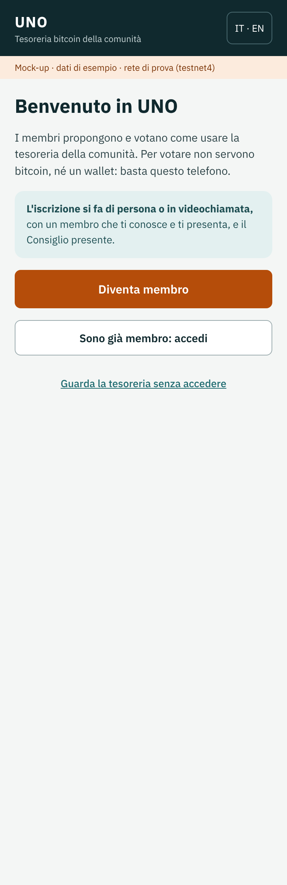 | 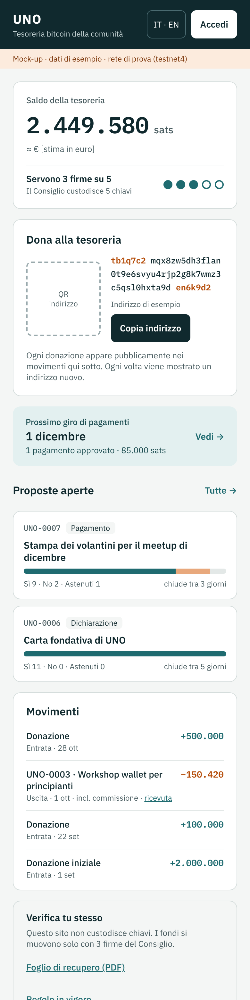 | 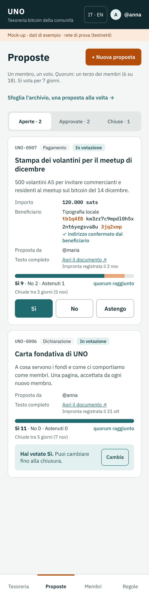 |

| Proposal and archive | New proposal | Recipient confirmation |
| --- | --- | --- |
| 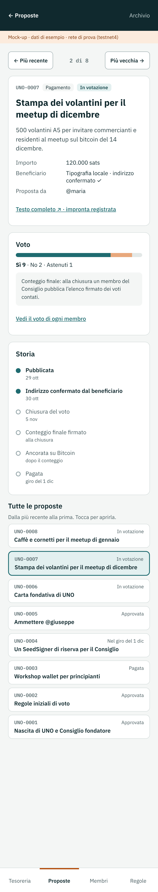 | 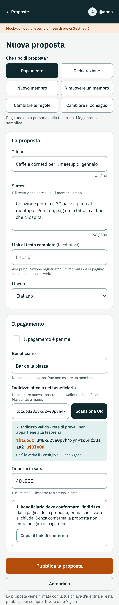 | 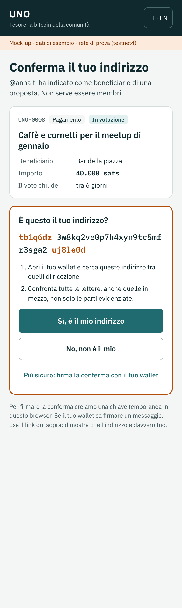 |

| Propose a new member | Profile, identity card and leaving | Restore from your identity card |
| --- | --- | --- |
| 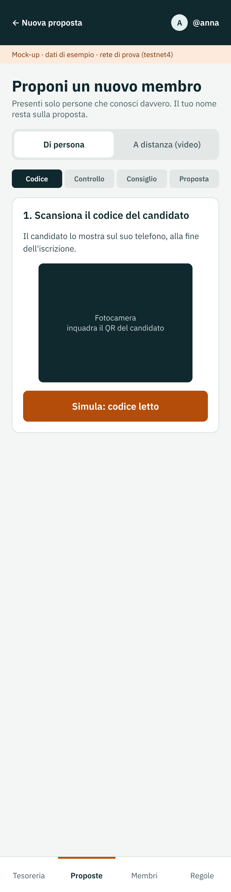 | 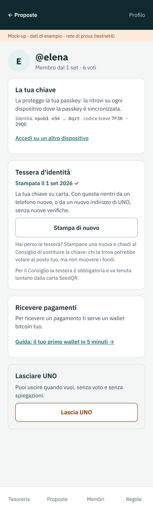 | 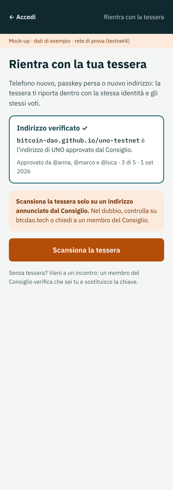 |

## Council

| Council inbox | Prepare a round | Sign a round |
| --- | --- | --- |
| 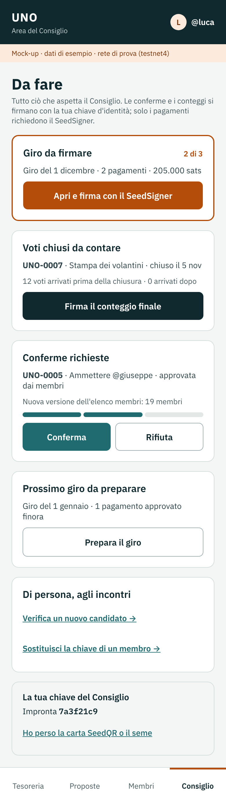 | 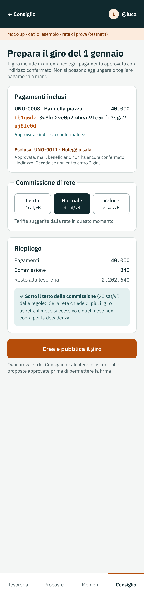 | 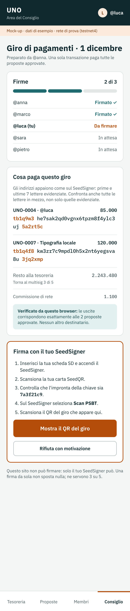 |

| Replace a member's key |
| --- |
| 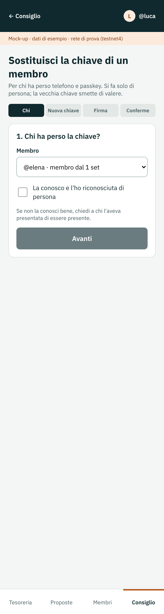 |

## Founding

| Founder sign-up | Prepare the founding (council) |
| --- | --- |
| 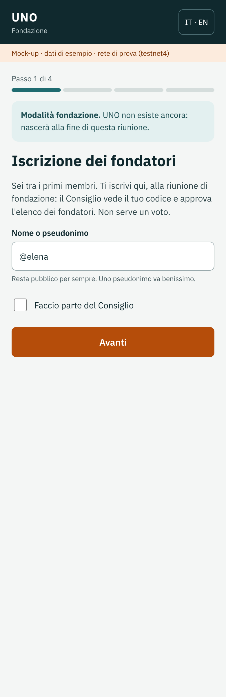 | 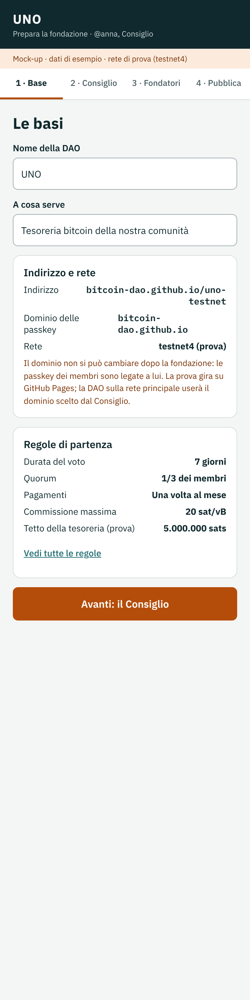 |

## Public reference

| Members | Rules |
| --- | --- |
| 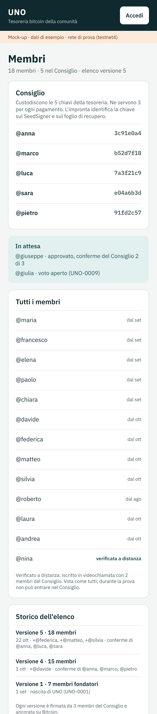 | 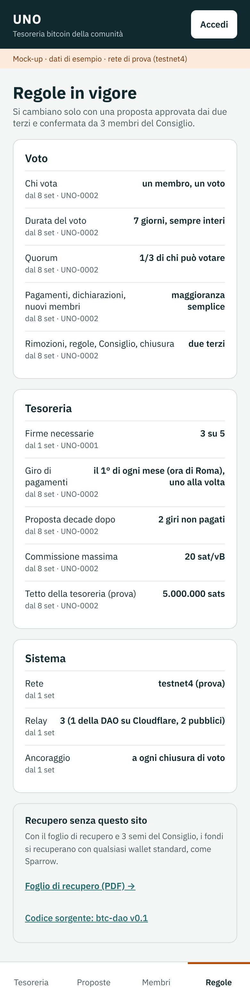 |

**Recovery sheet** (printable A4)

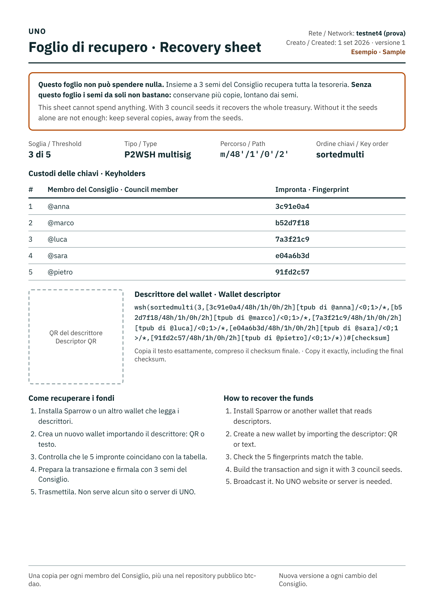

**Identity card** (printable A4: one card each, members and council)

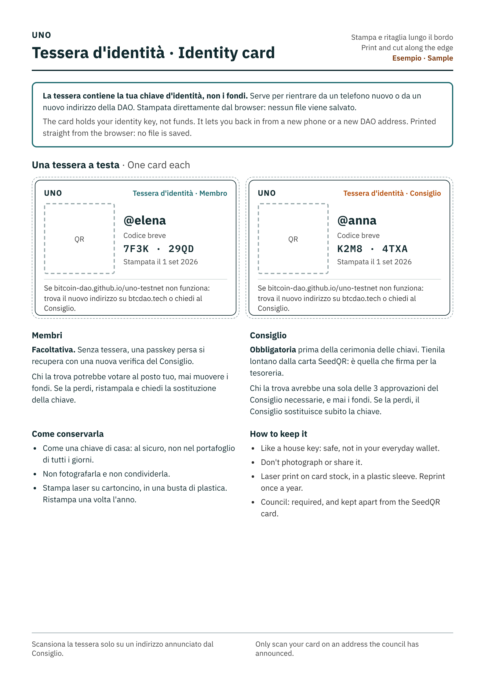

## Diagrams

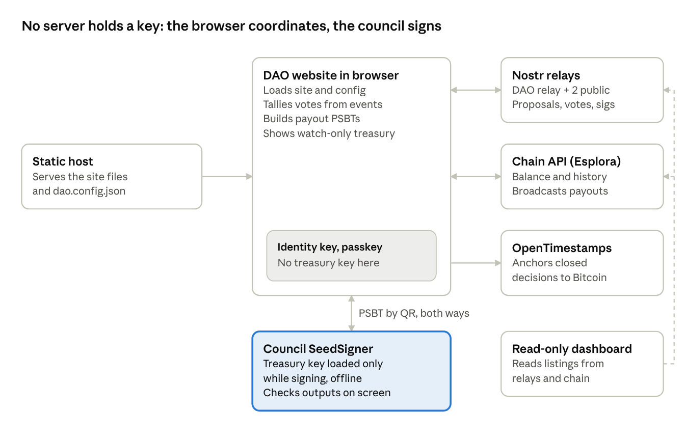

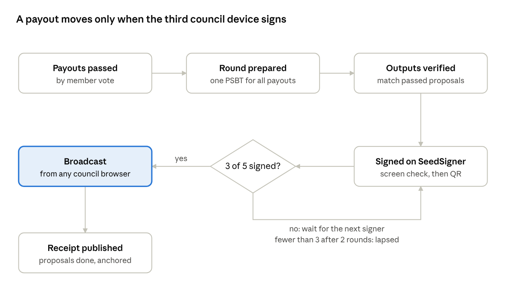
