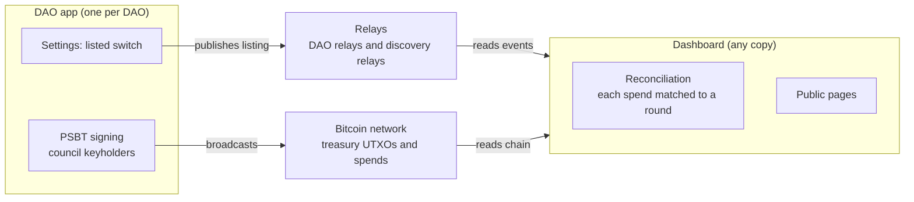

# btc-dao dashboard spec (draft 0.2)

November 2026. The read-only dashboard at btcdao.tech, built on the events in [`protocol.md`](protocol.md). It adds no new event kinds. It is needed once the first DAO reaches mainnet; until then, only the parts in the DAO app (section 4) and local reconciliation during the trial stages are built.

## 1. Purpose and principles

The dashboard is a block explorer for governance: it shows that btc-dao DAOs run, decide and spend only as agreed, without showing who their members are.

1. **Events and keys, never people.** It shows what happened, never who someone is.
2. **Aggregate across DAOs, never link across them.** Identity keys are already per DAO (salted with the DAO id); the dashboard never correlates keys between DAOs.
3. **Opt-in.** Every DAO event is public on relays by design (members consent to a public record). The dashboard still shows a DAO only if it chooses to be listed.
4. **A reader, not a registry.** The dashboard reads what DAOs publish and what the chain shows. There is nothing to register with and no account to hold. A btc-dao DAO starts publishing, and any dashboard that speaks the protocol picks it up, just as a Bitcoin node joins the network without asking permission.
5. **Verifiable, not trusted.** Every figure links to its source: a txid, a signed event, or a published descriptor. Anyone can run their own copy and get the same numbers.

## 2. Key metric: the reconciled treasury

The headline for every listed mainnet DAO is its whole on-chain treasury history, reconciled in real time, with **unauthorised spends: 0**. No registered company, co-op or association can show its members this.

**How reconciliation works**

1. The dashboard derives every treasury address from the descriptors in the DAO's endorsed `dao.settings` versions, current and earlier, and follows the full on-chain history: every receive, every spend, every UTXO.
2. For each spend, it looks for a `dao.round` (3581) whose unsigned transaction has that txid, and checks the round the way clients already do (protocol section 6.1): outputs are exactly the payouts of passed, tallied proposals, plus change to the treasury.
3. Each spend gets one status:
   - **Authorised**: matches a valid round (payout, closing, council-change migration or sweep round).
   - **Pending match**: seen in the mempool or a block, but no matching round has reached the dashboard yet.
   - **Unauthorised**: confirmed, and no valid round matches after a grace period.
4. The counter shows the number of unauthorised spends, with a link to each.

**Pledges stay ring-fenced.** Coins at a pledge address are held for one member. A spend that uses them is authorised only if its round pays that pledge's asset or refund and spends no other coins with them. Any other spend of pledge coins counts as unauthorised, even if a round matches it.

Because a round's txid is fixed by its unsigned transaction, a matching round proves the spend is exactly what the members voted for. The dashboard checks the chain itself rather than trusting `dao.receipt` (3583).

**What it proves, and what it doesn't.** It proves the treasury has moved only on recorded decisions. It does not prove the decisions were wise, or that a payee delivered.

The same check runs inside the DAO app during the trial stages, so the key metric is proven locally before it is shown in public.

## 2a. Steady I/O: is the funding model working?

Every listed DAO shows one number beside its declared funding model:

> **Steady I/O = median monthly inflow ÷ median monthly outflow, over the last 12 complete months**

It measures whether money arrives **regularly** compared with what the DAO regularly spends. Medians make it steady: a one-off donation of any size lands in a single month and does not move the number. Read beside the declared model, it tests the label without judging it.

- **Above 1:** regular income covers regular spending.
- **Below 1:** the DAO lives on its reserves or on occasional gifts.
- **Near 0:** no regular income, which is expected for a grant DAO.

**Definitions**

- **Months** are calendar months in the DAO's settings time zone (`rules.timezone`). Only complete months count.
- **Inflow** is every payment received at a treasury address, from any descriptor the DAO has used.
- **Outflow** is every reconciled spend: the payout outputs plus the network fee.
- **Not counted:** change back to the treasury, and sweeps from an earlier descriptor to the current one. Both are the DAO moving its own money.
- **Held for members, shown apart:** payments into a pledge address (money a member sets aside to buy an asset they will own, such as a panel; see the [member assets module](charter-modules/member-assets.md)) are not the DAO's income. They are shown as **pledged** beside the totals and left out of steady I/O, so a member buying an asset never looks like regular income. The payout that spends a pledge on the asset, or refunds it, is likewise left out of outflow.

**Shown with it**

- Totals in and out over the same 12 months, so a large donation is still visible.
- A 12-month chart of money in and out per month, so a one-off gift looks like one, and a steady stream looks like a stream.

**Edge cases**

- Fewer than 3 complete months since founding: "too new".
- Median monthly outflow of 0: "no regular spending", with the totals.
- The dashboard does not rank DAOs by this number.

## 3. Data sources

The dashboard has two inputs and writes nothing back:

- **Events:** the protocol's kinds 3570–3586, found from each listing (section 4) and fetched by the DAO's `D` tag from the relays named in it.
- **The chain:** read through the dashboard's own node or Electrum server, never a third-party explorer.

There is no database of record. The dashboard can be rebuilt from scratch at any time from relays and the chain, following protocol section 8.

## 4. Listing: one switch

**Key feature: permissionless listing.** A DAO appears on the dashboard through its own `dao.listing` (3585), endorsed by `threshold` council members as the protocol already requires. Every DAO and every dashboard copy is independent; there is no curated list, no registry and no approval step.

- **One switch in the app.** The DAO's settings page has one control: *show this DAO on public dashboards*. It sets `"listed": true` or `false` in the listing (protocol section 7.2). Like any listing change, it takes effect with `threshold` endorsements. The page says plainly that the switch governs display only: every event is public on the relays either way.
- **Discovery.** A listing with `"listed": true` is also published to the discovery relays (protocol section 7.4). Dashboards watch those relays, then fetch the rest of the DAO's events from the relays named in the listing.
- **Leaving** is the same switch: a new listing with `"listed": false` stops dashboards showing the DAO.
- **Spam limits itself.** An unendorsed listing is ignored. A listed DAO with no funded, reconciled treasury shows as such, and any copy may hide unfunded listings.
- **Mainnet first.** DAOs in their practice or testnet stage, read from the genesis config's `stage`, are shown apart and left out of network totals. Whether trial stages publish to relays at all is an open question (section 9).

## 5. Pages

Every listed DAO gets the same standard view. There are no per-item display choices.

**Front page.** Answers one question at a glance: are btc-dao DAOs real, active and clean?

- **Unauthorised spends, all DAOs: 0**: the lead figure, largest on the page.
- Listed DAOs on mainnet, by funding model, with how many have a steady I/O above 1.
- BTC held in mainnet treasuries, summed from their descriptors, with the part held for members shown apart.
- Spends reconciled to date.
- Proposals currently open for voting.

**DAO page**, like an address page in a block explorer:

- Name, site, stage, software version and build check (protocol section 7.2).
- Funding model (`rules.fundingModel`): shown as a label with a colour, never colour alone. Grant, production, mutual, revolving, or "not stated" when unset or unknown.
- **Steady I/O** beside the funding model, with the 12-month totals in and out and a monthly chart (section 2a).
- The reconciliation badge: authorised spends and **unauthorised spends: 0**, with the time of the last check.
- Treasury: balance in two parts, **DAO funds** (what the members decide on together) and **held for members** (open pledges, each with its progress), then UTXOs, multisig policy, and the full transaction history across every descriptor the DAO has used, each row tagged received, authorised spend, pending match or unauthorised.
- Member count and council count.
- Proposal list, newest first, with number, status and tally.

**Proposal page**, like a transaction page: one timeline, each step with its time and the event that proves it.

1. **Opened**: `dao.proposal` (3574), with title and summary.
2. **Confirmed**: `dao.confirm` (3575), where a payout recipient must confirm the address.
3. **Tallied**: `dao.tally` (3577), with yes, no, abstain and the result. A failed proposal ends here.
4. **Anchored**: `dao.anchor` (3584).
5. **In a round**: `dao.round` (3581), then **signed** to the threshold (`dao.sign`, 3582, shown as a count).
6. **Paid**: the txid and block height, and the spend marked authorised by reconciliation.

A proposal that moves no funds stops at step 4. A passed payout not paid by its second round date shows as lapsed (protocol section 6.1).

**Later, not in the first version:** health figures (time from tally to payment, turnout, share of payouts paid before they lapse) and a live event feed on the front page.

## 6. Never displayed

The dashboard never shows these, for any DAO:

- The roster, individual votes, or which member made a proposal. Names stay in each DAO's own app.
- Which council members signed a round, only how many.
- Anything tying a key to a legal name, and any link between keys in different DAOs, including shared payout addresses.
- Labels on payout recipients beyond the address and txid the chain already shows.
- Network metadata: IP addresses, locations, devices, relays a member used.

**What is public anyway.** All events are on public relays, the descriptor is in the listing, and with the current P2WSH multisig each spend shows on chain which council keys signed. Members should use a fresh receive address for every payout, which the app should request automatically.

## 7. Diagram

## 8. Tasks

- [ ] Add the *show on public dashboards* switch to the DAO app's settings page, setting `listed` in the listing.
- [ ] Run reconciliation locally in the DAO app during the trial stages.
- [ ] Pick the discovery relays shipped with the first release, and set up the btcdao.tech relay with the discovery policy.
- [ ] Confirm kinds 3570–3586 are unused on large relays (`decisions.md`).
- [ ] Write the protocol up as a draft NIP, with the app (publisher) and the dashboard (reader) as its two implementations, and submit it to nostr-protocol/nips after the first mainnet DAO.

## 9. Open questions

- [ ] Should testnet stages publish their events to relays, or keep all data local to the DAO? The protocol currently publishes them through the DAO relay.
- [ ] Grace period before a confirmed, unmatched spend is marked unauthorised.
- [ ] How a pledge address is put on the public record, so dashboards can find it: a statement proposal at first, a `pledge` proposal type later?
- [ ] Should a DAO be able to hide which council keys signed on chain (for example with a Taproot multisig)?
- [ ] Who hosts the reference instance at btcdao.tech, and how do others run their own?
